<h1 align="center">Hi there, I'm Taha Ahmed!!</h1>

 

## About Me:

- 🎓 I `graduated` from the Faculty of Computers & AI at Cairo University.
- 📄 Here is my <a href="https://drive.google.com/file/d/1KYw7hrEaF5l20HQ5PhU3Zmdg0lMSlPrg/view?usp=sharing" target="_blank">Resume</a>.
   

## Contact Me

	
	&emsp;
	
	&emsp;
	
	&emsp;
	
	&emsp;

 

## 🛠️ My tools

### 👨‍💻 Programming languages

    
    
    

<!--      -->
<!--      -->
<!--      -->
<!--      -->

### 🧰 Frameworks, Technologies and libraries

	

	
	
	
	
	
	
	
	
	
	

### 💻 Software and tools

	

	
	
	
	
	

<h3>PacMen are Eating my Contributions!!</h3>
<picture>
  <source media="(prefers-color-scheme: dark)" srcset="https://raw.githubusercontent.com/TahaAhmedT/TahaAhmedT/output/pacman-contribution-graph-dark.svg">
  <source media="(prefers-color-scheme: light)" srcset="https://raw.githubusercontent.com/TahaAhmedT/TahaAhmedT/output/pacman-contribution-graph.svg">
  
</picture>
